# Expedition Background Art — Avery + Mira

**Status:** Working production checklist. Assets are only added after Avery explicitly approves the finished image. **Do not integrate assets into gameplay or merge this PR without Avery's approval.**

## Shared art direction

- **13 landscape compositions total**, not 26: the same dive/porthole window uses the same background on mobile and desktop.
- The **52 region × depth combinations** reuse these backgrounds with region-specific details where appropriate.
- Static artwork is the **scenery layer**, not the whole scene. Leave most of the frame open for moving animal silhouettes.
- **No visible water surface and no baked-in light rays.** The existing animated sunlight/background effects are separate; avoid making them look frozen by duplicating them in the still.
- Keep prominent scenery near the **bottom ~10%** where practical. Especially for tropical surface, preserve broad unobstructed blue open water.
- At depth, backgrounds converge: reuse one twilight scene and one deep-dark scene across all regions. No mandatory visible seafloor in pelagic/deep water.
- **North Carolina shipwreck belongs in 30–100 m shallows, not the surface.**
- A checked item below means **visual art approved**, **not** integrated, scientifically audited, or tested in iPad Safari.

## 13-image production checklist

| ID | Environment | Coverage | Status |
| --- | --- | --- | --- |
| **BG-01-L** | Tropical surface | Caribbean, Philippines, Maldives, Papua New Guinea | **✅ Approved / locked** |
| **BG-02-L** | Temperate surface | NC, Japan, Cornwall, South Africa, eastern Australia | **✅ Approved / locked** |
| **BG-03-L** | Open Atlantic surface | Open Atlantic | **✅ Approved / locked** |
| **BG-04-L** | Kelp surface | California | **✅ Approved / locked** |
| **BG-05-L** | Volcanic surface | Galápagos | **✅ Approved / locked** |
| **BG-06-L** | Polar surface | Arctic | **✅ Approved / locked** |
| **BG-07-L** | Tropical shallows | Four tropical regions | **✅ Approved / locked** |
| **BG-08-L** | Rocky shallows | Japan, Cornwall, South Africa, eastern Australia, California, Galápagos | **✅ Approved / locked** |
| **BG-09-L** | Open Atlantic shallows | Open Atlantic | **✅ Approved / locked** |
| **BG-10-L** | Arctic shallows | Arctic | **✅ Approved / locked** |
| **BG-11-L** | North Carolina wreck shallows | NC only, 30–100 m | **✅ Approved / locked** |
| **BG-12-L** | Shared twilight | All 13 regions, 100–400 m | **✅ Approved / locked** |
| **BG-13-L** | Shared deep dark | All 13 regions, 400–1000 m | **✅ Approved / locked** |

## BG-01-L: Tropical Surface — APPROVED ✅

**Approved by Avery:** 2026-10-19, after multiple visual revisions.

- **Browser asset:** [bg-01-tropical-surface.webp](../assets/expedition-backgrounds/bg-01-tropical-surface.webp), full size 1672 × 941, high-quality WebP.
- **Original approved image:** [bg-01-tropical-surface-original.png](../assets/expedition-backgrounds/source/bg-01-tropical-surface-original.png), original 1672 × 941 PNG. Keep this master source unchanged.
- **Art requirements confirmed:** Mostly uninterrupted ocean blue (~90%); coral and rocky reef remain along the very bottom (~10%). Enough clear central space for moving animal shadows. **No visible surface and no static sunbeams.**
- **Reuse:** Caribbean / Philippines / Maldives / Papua New Guinea at surface depth. Region-specific animal pools continue to be determined by game logic, not by baking animals into this image.
- **Integration:** Art is approved; gameplay wiring, blend/layer stacking, fallback, and in-device tests are **not** approved by this asset-only step.

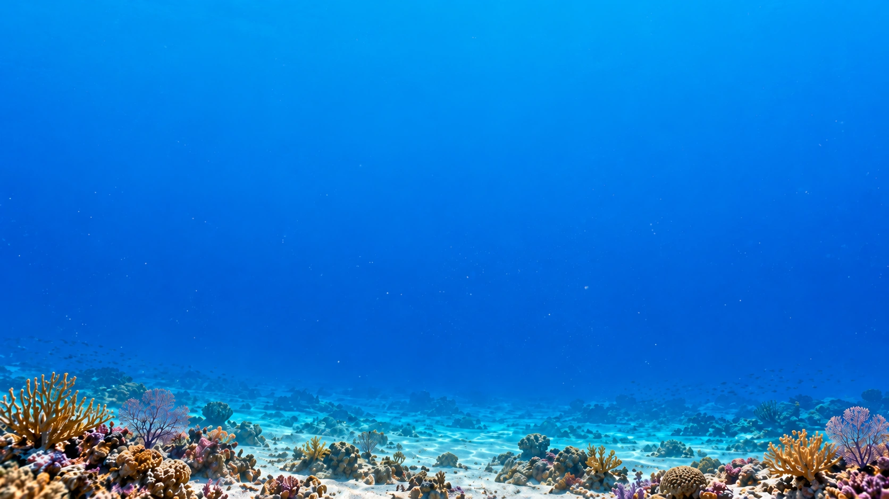

## BG-02-L: Temperate Surface — APPROVED ✅

**Approved by Avery:** 2026-10-19, on first visual candidate.

- **Browser asset:** [bg-02-temperate-surface.webp](../assets/expedition-backgrounds/bg-02-temperate-surface.webp), full size 1672 × 941, high-quality WebP.
- **Original approved image:** [bg-02-temperate-surface-original.png](../assets/expedition-backgrounds/source/bg-02-temperate-surface-original.png), original 1672 × 941 PNG. Preserve this source master.
- **Art requirements confirmed:** Cool, subdued temperate blue water with open space for independently animated animal silhouettes. Rocky seabed and sparse short seaweed occupy the lower edge; no visible water surface, no baked-in sun rays, no animals, and no wreck.
- **Reuse:** North Carolina, Sagami Bay/Japan, Cornwall, South Africa, and eastern Australia at surface depth. North Carolina's shipwreck will appear only in the separately approved **BG-11-L** shallow-depth (30–100 m) asset.
- **Integration:** Visual approval only. This asset is not wired into gameplay and has not been verified for layering, colour treatment, performance, or iPad Safari rendering yet.

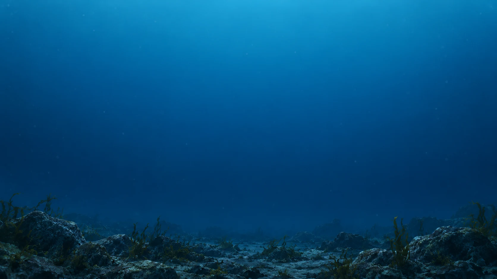

## BG-03-L: Open Atlantic Surface — APPROVED ✅

**Approved by Avery:** 2026-10-19, on first visual candidate.

- **Browser asset:** [bg-03-open-atlantic-surface.webp](../assets/expedition-backgrounds/bg-03-open-atlantic-surface.webp), full size 1672 × 941, optimized WebP.
- **Original approved image:** [bg-03-open-atlantic-surface-original.png](../assets/expedition-backgrounds/source/bg-03-open-atlantic-surface-original.png), original 1672 × 941 PNG. Preserve the exact approved original unchanged.
- **Art requirements confirmed:** Uninterrupted open Atlantic water across the entire frame; natural blue depth gradient (lighter upper water, deeper/darker lower water), restrained atmospheric depth haze and very subtle suspended particulate matter. **No visible surface, static light rays or caustic patterns, animals, coral, coast, seafloor, vegetation, wrecks, or other structures.** The frame stays unobstructed for separately animated wildlife silhouettes.
- **Reuse:** Open Atlantic region at surface depth (0–30 m). A separate darker pelagic background, BG-09-L, is planned for 30–100 m.
- **Integration:** Visual approval only. Do not change the expedition rendering code, sunlight animation, wildlife layers, or gameplay as part of this asset collection. Device testing and integration remain pending Avery's separate authorization.

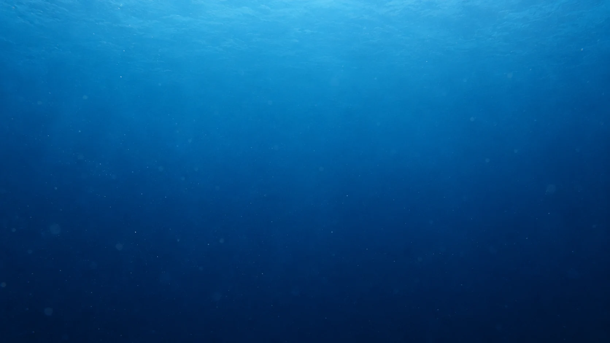

## BG-04-L: California Kelp Forest Surface — APPROVED ✅

**Approved by Avery:** 2026-10-19, after one art-direction revision.

- **Browser asset:** [bg-04-kelp-surface.webp](../assets/expedition-backgrounds/bg-04-kelp-surface.webp), full size 1672 × 941, optimized WebP.
- **Original approved image:** [bg-04-kelp-surface-original.png](../assets/expedition-backgrounds/source/bg-04-kelp-surface-original.png), original 1672 × 941 PNG. This is the exact approved second candidate; preserve this master unchanged.
- **Art requirements confirmed:** California coastal blue-teal open-water gradient with diffuse underwater haze. **Kelp, rocky seabed, and vegetation must stay confined to the bottom 5–10% of the image.** The remaining ~90–95% is uninterrupted blue gradient water for moving animal silhouettes. No tall kelp stalks or side framing, visible surface, static sunbeams/caustics, animals, or man-made objects.
- **Reuse:** California region at surface depth (0–30 m). Shallows will use a separately approved rocky-shallows treatment as planned.
- **Integration:** Visual approval only. Image is stored as a standalone asset; no expedition rendering code, animated sunlight, wildlife layers, or gameplay changes are authorized by this step. Device testing remains pending.

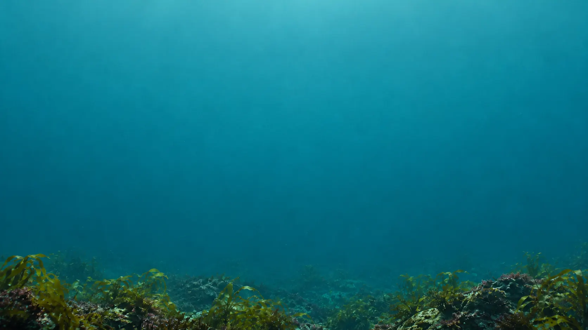

## BG-05-L: Galápagos Volcanic Surface — APPROVED ✅

**Approved by Avery:** 2026-10-19, on first visual candidate.

- **Browser asset:** [bg-05-volcanic-surface.webp](../assets/expedition-backgrounds/bg-05-volcanic-surface.webp), full size 1672 × 941, optimized WebP.
- **Original approved image:** [bg-05-volcanic-surface-original.png](../assets/expedition-backgrounds/source/bg-05-volcanic-surface-original.png), original 1672 × 941 PNG. Preserve this exact approved master image unchanged.
- **Art requirements confirmed:** Calm, photo-realistic Galápagos near-surface environment with mostly uninterrupted gradient-blue open water for independently moving wildlife silhouettes. Distinctive dark, irregular angular volcanic basalt and very sparse growth are restricted to low rocky seabed scenery along the bottom edge. No tall foreground obstructions, visible water surface, baked-in sun rays or caustics, animals, coral forest, or man-made structures.
- **Reuse:** Galápagos region at surface depth (0–30 m). At 30–100 m, use the separately approved rocky-shallows asset BG-08-L, with regional basalt treatment to be considered when that artwork is reviewed.
- **Integration:** Art approval and storage only. No expedition rendering, sunlight animation, wildlife-layer, or gameplay changes are authorized. Device testing and integration remain pending separate approval.

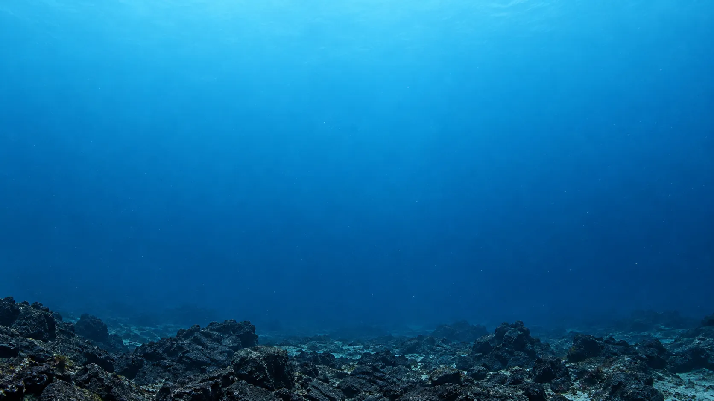

## BG-06-L: Arctic Polar Surface — APPROVED ✅

**Approved by Avery:** 2026-10-19, on first visual candidate.

- **Browser asset:** [bg-06-arctic-surface.webp](../assets/expedition-backgrounds/bg-06-arctic-surface.webp), full size 1672 × 941, optimized WebP.
- **Original approved image:** [bg-06-arctic-surface-original.png](../assets/expedition-backgrounds/source/bg-06-arctic-surface-original.png), original 1672 × 941 PNG. Preserve this exact approved master unchanged.
- **Art requirements confirmed:** Calm, photorealistic polar underwater scene with a cold, pale cyan to deep steel-blue gradient, diffused ambient light, subtle suspended particulates, and expansive unobstructed water for animated animal silhouettes. Low pale ice-like formations, rocky seabed, and subdued icy accents remain near the bottom edge rather than hanging down from above. No visible surface boundary, pronounced static sunbeams or caustics, animals, kelp, coral, wrecks, or man-made objects.
- **Reuse:** Arctic region at surface depth (0–30 m). Arctic shallows (30–100 m) will use a separately approved BG-10-L image.
- **Integration:** Visual art approval and storage only. Do not modify expedition rendering code, sunlight animations, wildlife layers, or gameplay in this asset-production step. Device testing and integration remain pending Avery's separate authorization.

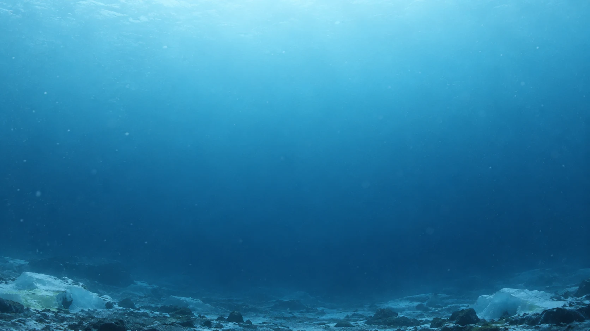

## BG-07-L: Tropical Shallows — APPROVED ✅

**Approved by Avery:** 2026-10-19, on first visual candidate.

- **Browser asset:** [bg-07-tropical-shallows.webp](../assets/expedition-backgrounds/bg-07-tropical-shallows.webp), full size 1672 × 941, optimized WebP.
- **Original approved image:** [bg-07-tropical-shallows-original.png](../assets/expedition-backgrounds/source/bg-07-tropical-shallows-original.png), original 1672 × 941 PNG. Preserve this exact approved master unchanged.
- **Art requirements confirmed:** Calmer, darker tropical blue gradient than BG-01 surface water, with subtle depth haze and broad uninterrupted space for separately animated wildlife silhouettes. Low, subdued coral heads, small rocky reef details and scattered sediment remain in roughly the bottom 5–10% of the frame. No visible water surface, baked-in sunbeams or caustics, animals, tall reef formations, or man-made objects.
- **Reuse:** Caribbean, Philippines, Maldives and Papua New Guinea at shallow depth (30–100 m). Wildlife and species selection stay controlled by game logic, not baked into this scenery.
- **Integration:** Visual artwork approved and stored as a standalone asset only. Do not change expedition rendering, animated sunlight, wildlife layers, or gameplay at this stage. Device testing and integration remain pending separate approval.

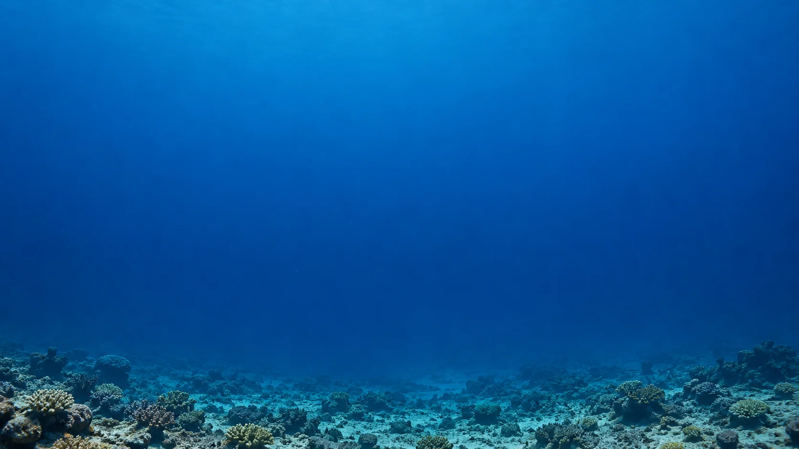

## BG-08-L: Rocky Shallows — APPROVED ✅

**Approved by Avery:** 2026-10-19.

- **Browser asset:** [bg-08-rocky-shallows.webp](../assets/expedition-backgrounds/bg-08-rocky-shallows.webp), full size 1672 × 941, high-quality WebP.
- **Original approved image:** [bg-08-rocky-shallows-original.png](../assets/expedition-backgrounds/source/bg-08-rocky-shallows-original.png). Keep this master source unchanged.
- **Art requirements confirmed:** Temperate rocky reef shallows with low rock formations and sparse algae along the bottom edge. Open blue water above for animal silhouettes. No visible surface, no baked-in light rays.
- **Reuse:** Japan, Cornwall, South Africa, eastern Australia, California, Galápagos at reef/shallows depth (30–100 m).
- **Integration:** Art is approved; gameplay wiring and device tests are **not** approved by this asset-only step.

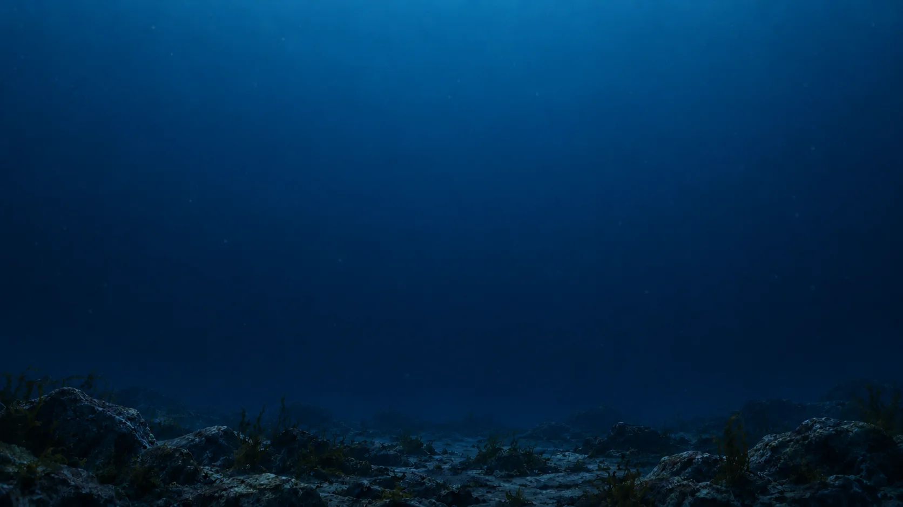

## BG-09-L: Open Atlantic Shallows — APPROVED ✅

**Approved by Avery:** 2026-10-19.

- **Browser asset:** [bg-09-open-atlantic-shallows.webp](../assets/expedition-backgrounds/bg-09-open-atlantic-shallows.webp), full size 1672 × 941, high-quality WebP.
- **Original approved image:** [bg-09-open-atlantic-shallows-original.png](../assets/expedition-backgrounds/source/bg-09-open-atlantic-shallows-original.png). Keep this master source unchanged.
- **Art requirements confirmed:** Open Atlantic water at shallows depth — darker blue gradient than surface, subtle particulate, unobstructed frame for wildlife silhouettes. No seafloor, no structures.
- **Reuse:** Open Atlantic region at reef/shallows depth (30–100 m).
- **Integration:** Art is approved; gameplay wiring and device tests are **not** approved by this asset-only step.

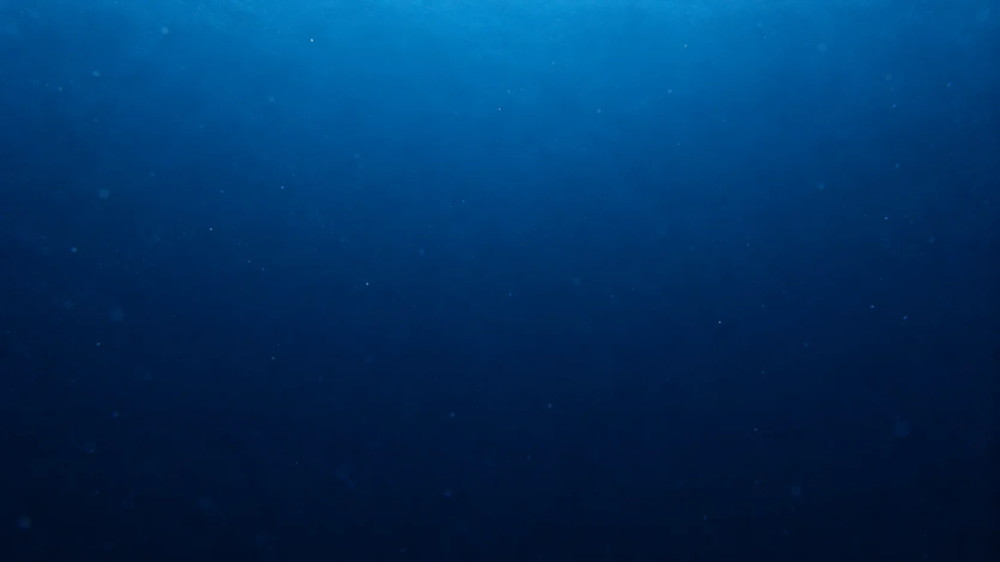

## BG-10-L: Arctic Shallows — APPROVED ✅

**Approved by Avery:** 2026-10-19.

- **Browser asset:** [bg-10-arctic-shallows.webp](../assets/expedition-backgrounds/bg-10-arctic-shallows.webp), full size 1672 × 941, high-quality WebP.
- **Original approved image:** [bg-10-arctic-shallows-original.png](../assets/expedition-backgrounds/source/bg-10-arctic-shallows-original.png). Keep this master source unchanged.
- **Art requirements confirmed:** Cold polar shallows with low ice/rock formations along the bottom edge. Pale cyan to steel-blue gradient, open water for animal silhouettes. No visible surface, no baked-in light rays.
- **Reuse:** Arctic region at reef/shallows depth (30–100 m).
- **Integration:** Art is approved; gameplay wiring and device tests are **not** approved by this asset-only step.

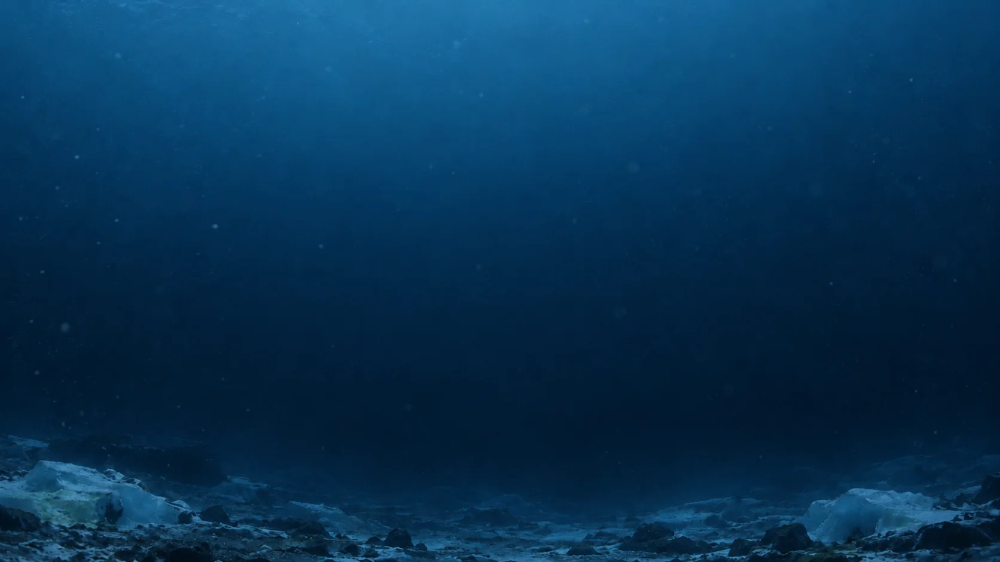

## BG-11-L: North Carolina Wreck Shallows — APPROVED ✅

**Approved by Avery:** 2026-10-19.

- **Browser asset:** [bg-11-north-carolina-wreck-shallows.webp](../assets/expedition-backgrounds/bg-11-north-carolina-wreck-shallows.webp), full size 1672 × 941, high-quality WebP.
- **Original approved image:** [bg-11-north-carolina-wreck-shallows-original.png](../assets/expedition-backgrounds/source/bg-11-north-carolina-wreck-shallows-original.png). Keep this master source unchanged.
- **Art requirements confirmed:** Distant shipwreck silhouette on a rocky seabed (Graveyard of the Atlantic). Wreck is background atmosphere, not a focal point. Open water above for animal silhouettes. **Wreck appears ONLY at shallows depth (30–100 m); NC surface uses BG-02 with no wreck.**
- **Reuse:** North Carolina region ONLY, at reef/shallows depth (30–100 m).
- **Integration:** Art is approved; gameplay wiring and device tests are **not** approved by this asset-only step.

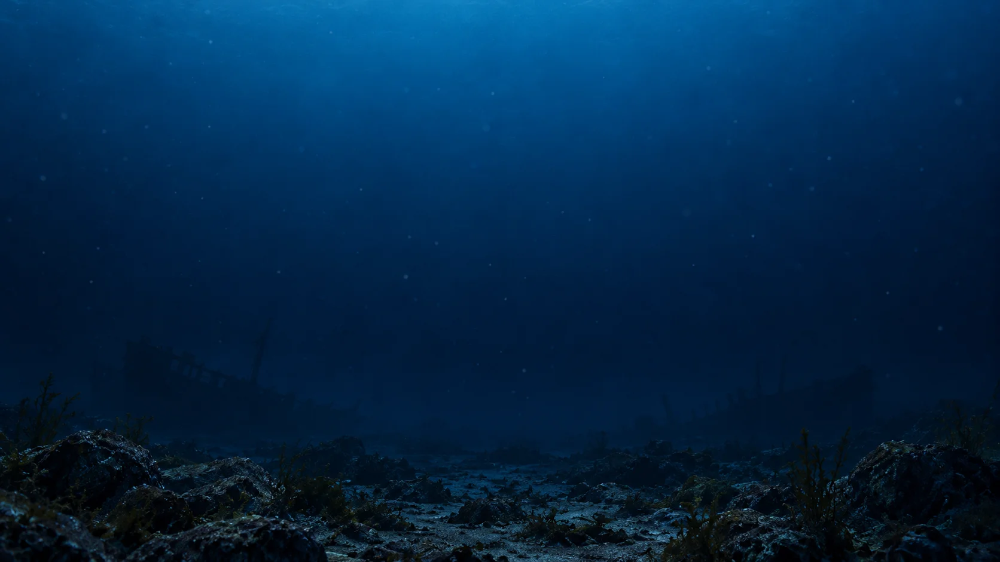

## BG-12-L: Shared Twilight — APPROVED ✅

**Approved by Avery:** 2026-10-19.

- **Browser asset:** [bg-12-shared-twilight.webp](../assets/expedition-backgrounds/bg-12-shared-twilight.webp), full size 1672 × 941, high-quality WebP.
- **Original approved image:** [bg-12-shared-twilight-original.png](../assets/expedition-backgrounds/source/bg-12-shared-twilight-original.png). Keep this master source unchanged.
- **Art requirements confirmed:** Deep twilight-zone water — very dark blue gradient with faint ambient glow. Minimal seabed detail. Unobstructed for deep-water animal silhouettes and marine snow.
- **Reuse:** ALL 13 regions at twilight depth (100–400 m).
- **Integration:** Art is approved; gameplay wiring and device tests are **not** approved by this asset-only step.

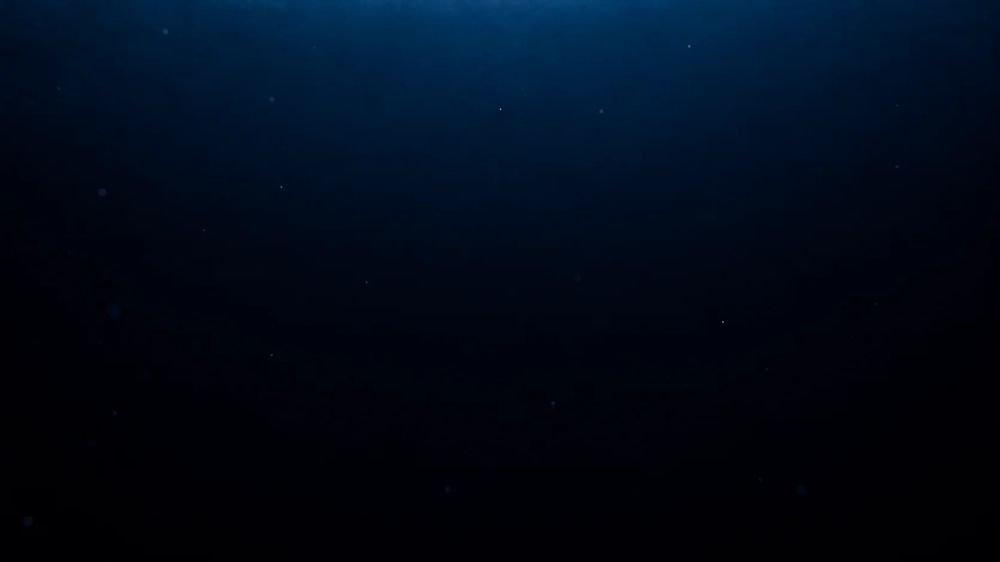

## BG-13-L: Shared Deep Dark — APPROVED ✅

**Approved by Avery:** 2026-10-19.

- **Browser asset:** [bg-13-shared-deep-dark.webp](../assets/expedition-backgrounds/bg-13-shared-deep-dark.webp), full size 1672 × 941, high-quality WebP.
- **Original approved image:** [bg-13-shared-deep-dark-original.png](../assets/expedition-backgrounds/source/bg-13-shared-deep-dark-original.png). Keep this master source unchanged.
- **Art requirements confirmed:** Near-black deep water with the faintest blue gradient. No visible seabed or structures. Backdrop for deep-water silhouettes and marine snow.
- **Reuse:** ALL 13 regions at deep depth (400–1000 m).
- **Integration:** Art is approved; gameplay wiring and device tests are **not** approved by this asset-only step.

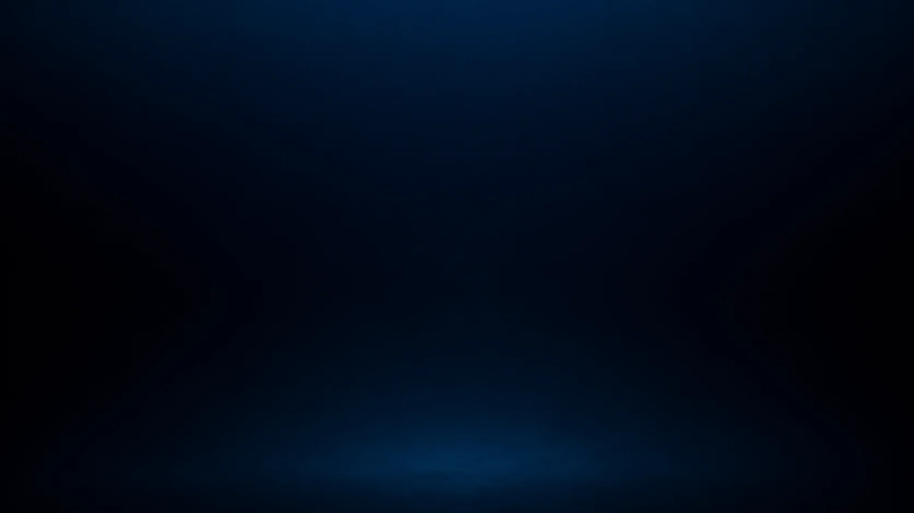
